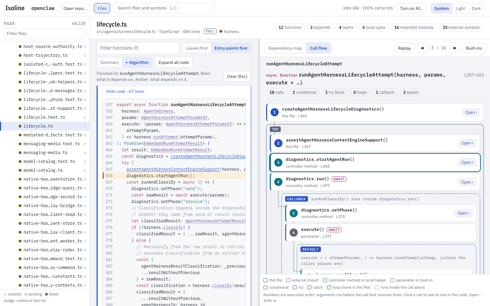

<p align="center"></p>

# Isoline

A desktop app for understanding code without reading every line. Open a repo and Isoline
shows, for any file, a reading list of function cards grouped by layer, a dependency map, and
a step-by-step call flow, with the code one click away in a Monaco editor.

Structure comes from deterministic parsing: tree-sitter, oxc_resolver and SQLite, all in Rust.
A model is used only for one-line summaries, module names and colors, through the user's own
GitHub Copilot sign-in, and never before the user turns AI on for a repo.



## What it does

- **Any repo, any size.** Indexes 14.6M lines (openclaw, 64k files) in about 45 s on a
  laptop, reopens it in about 0.3 s, and opens a file in under 5 ms at the 95th percentile.
  Reindexing after an edit takes about 20 ms and touches only that file.
- **Three views per file**, from the prototype: function cards (summary, algorithm steps,
  notes, calls, imports, callers, code on demand), the dependency map (layers by longest call
  path, entry points left, external imports right, focus and transitive impact), and the call
  flow (numbered calls in true execution order inside if, try, catch, loop and callback
  frames, stepping that highlights each line in Monaco, drill-down into callees).
- **Five languages in full** (TypeScript, JavaScript, Python, Rust, HTML/CSS), an outline tier
  for Go, Java and C# driven only by tree-sitter query files, and a text tier for everything
  else. The tier is shown on every file.
- **Cross-file graph**: imports resolved through tsconfig paths, workspace packages,
  Python package roots and Cargo workspaces; call edges marked exact or heuristic; precise
  indexers (rust-analyzer, scip-typescript, scip-python) upgrade edges when installed.
- **Modules and colors**: the source tree is clustered into modules from directories and the
  import graph, colored, and renamable. Files and folders in the tree carry their module's
  color.
- **Architecture**: with AI on, one run names every module and writes the repo's
  architecture: what the system does, its layers from entry points to foundations, and the
  major flows of requests and data between modules, shown as colored module chains above the
  module map. It reads only the module graph and whatever summaries are cached, so it costs
  cents for a mid-size repo (about $0.70 for openclaw's 637 modules).
- **Gets faster with use**: everything derived is cached by content hash, so a branch switch
  back and forth costs nothing and AI summaries are never paid for twice.

## Install

Download a build for macOS, Windows or Linux (arm64 and x64) from the
[latest release](https://github.com/zabirauf/isoline/releases/latest): a `.dmg` for macOS,
an installer `.exe` or `.msi` for Windows, and an `.AppImage`, `.deb` or `.rpm` for Linux.
Each release also has the `iso-cli` binary for every target and a `SHA256SUMS.txt`. The builds
are not code-signed yet; see the release notes for opening them the first time.

To try what's on `main` without waiting for a release, use the
[nightly](https://github.com/zabirauf/isoline/releases/tag/nightly) pre-release. It is rebuilt
on every push to `main`, keeps the same file names (`Isoline_nightly_aarch64.dmg` and so on),
and is never marked Latest. On macOS or Linux, this installs it, or updates an existing install
in place:

```sh
curl -fsSL https://raw.githubusercontent.com/zabirauf/isoline/main/scripts/install.sh | sh
# --stable for the latest release instead, --cli to add iso-cli to ~/.local/bin
```

With Nix (flakes), build from source (the flake follows `main`):

```sh
nix run github:zabirauf/isoline                 # the desktop app
nix run github:zabirauf/isoline#iso-cli -- --help
nix profile install github:zabirauf/isoline      # or add overlays.default to your config
```

## Layout

| Path | What |
| --- | --- |
| `crates/iso-core` | Shared types, IPC payloads (TypeScript bindings generated into `app/ui/src/ipc/bindings`) |
| `crates/iso-walk` | Gitignore-aware walk, content hashing, Merkle tree, watcher |
| `crates/iso-parse` | tree-sitter parser pool, per-language extractors, the call-flow walker |
| `crates/iso-resolve` | Import resolution per language, SCIP import |
| `crates/iso-index` | SQLite schema and queries |
| `crates/iso-graph` | Layers, cycles, impact, module clustering |
| `crates/iso-cache`, `iso-jobs` | Content-addressed cache with early cutoff; priority queue |
| `crates/iso-ai` | Skeletons, Provider trait, budget, leaf/cluster/repo passes |
| `crates/iso-engine` | The operations behind every command, shared by the app and the CLI |
| `crates/iso-cli` | Every feature headless: `index`, `file`, `flow`, `impact`, `search`, `bench`, `eval`, `serve` |
| `sidecar/copilot` | Go sidecar: Copilot SDK behind JSON-RPC on stdio, with a mock mode |
| `app/src-tauri` | Tauri 2 shell |
| `app/ui` | React + TypeScript + Vite, Monaco behind one `EditorHost` |
| `fixtures/` | Small repos per language with hand-written expected output |
| `eval/` | Validation repo list and results per round |

Contracts between the parts are in `CONTRACTS.md`. The build brief, design system and
prototype are in `docs/handoff/`. Status against the plan is in `docs/STATUS.md`; validation
results are in `docs/EVAL.md`.

## Build and run

Needs Rust (stable), Node 22+, and Go 1.23+ (Go 1.26 is fetched automatically for the live
Copilot sidecar build).

```sh
# UI dependencies and the Tauri CLI
(cd app/ui && npm ci) && (cd app && npm ci)

# Run the desktop app in development (Vite dev server + Tauri)
cd app && npm run dev

# Build the app (UI, sidecar and a release bundle)
cd app && npm run build

# Open a repo straight from the command line
./target/release/isoline /path/to/repo [path/inside/repo.ts]
```

Headless:

```sh
cargo run --release -p iso-cli -- -r /path/to/repo index          # index, print the report
cargo run --release -p iso-cli -- -r /path/to/repo file src/a.ts  # the file view as JSON
cargo run --release -p iso-cli -- -r /path/to/repo flow src/a.ts  # call flow, analyze.js shape
cargo run --release -p iso-cli -- -r /path/to/repo bench          # the performance targets
cargo run --release -p iso-cli -- eval --round round-3            # the validation loop
cargo run --release -p iso-cli -- serve                           # UI + engine on 127.0.0.1:7777
```

`iso-cli serve` is a development bridge: it serves the built UI and the engine over HTTP on
127.0.0.1 only (open `http://127.0.0.1:7777/?backend=http&repo=/path/to/repo`), which is how
screenshots of real data are taken headlessly (`app/ui/scripts/screenshots-real.mjs`). The
desktop app never uses it. Without either backend, `npm run dev` in `app/ui` runs the UI on
the prototype's mock data.

## Test

```sh
cargo fmt --all --check && cargo clippy --workspace --all-targets -- -D warnings
cargo test --workspace                       # unit, golden and acceptance tests
(cd sidecar/copilot && go vet ./... && go test ./...)
(cd app/ui && npm run typecheck && npm test && npm run build)
(cd app/ui && node scripts/screenshots.mjs)  # mock-data screenshots in light and dark
```

## AI summaries

Off by default, per repo. Turning it on starts the sidecar; nothing leaves the machine before
that. Once it is on, a file is summarized when it opens if its estimate is under $0.05 (about
a tenth of a cent is typical; this can be switched off in the AI panel), with progress at the
top of the file. A module or the whole repo is summarized from the AI panel, which shows the
estimate first, as does the architecture overview on the repo page. Requests go out six at a
time. Every run has a budget it cannot exceed. Model text is written in ASD-STE100
Simplified Technical English: short sentences, the active voice, one meaning for each word. Sign in
with a GitHub account that has a Copilot plan (device flow through Isoline's OAuth app; the
token stays in the OS keychain). Release builds embed the Copilot CLI, whose license ships in
the app as `licenses/github-copilot-cli.txt`. `ISOLINE_GITHUB_CLIENT_ID` overrides the OAuth
app.
`ISOLINE_SIDECAR_MOCK=1` runs the full pipeline against the sidecar's deterministic mock.

## License

MIT.
