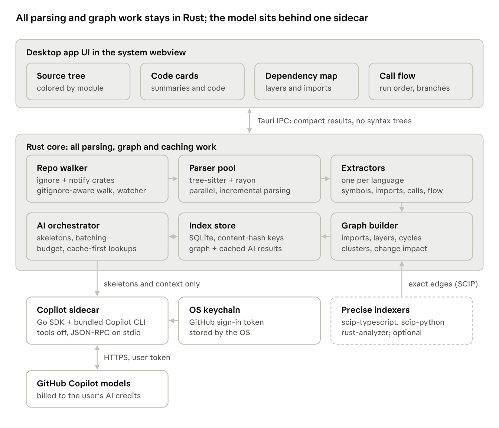
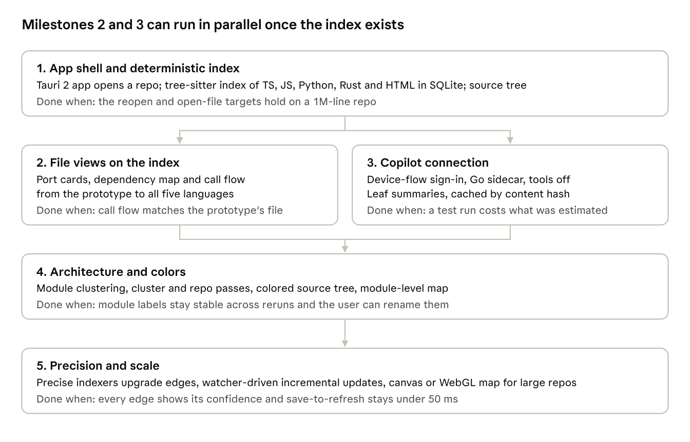

# Code Map Desktop: Deterministic vs LLM Analysis Plan

Nov 15, 2026 · @Zohaib Rauf

## Recommendation

Use deterministic code for everything structural and spend LLM tokens only on meaning. Every view in the current prototype except the descriptions, algorithm steps and notes already comes from code, and that holds at repo scale.

- **Code owns structure:** files, symbols, imports, call graph, call flow, layers, cycles, entry points and change impact.

- **The LLM owns meaning:** one-line summaries, module names, architecture roles, directory colors and risk notes.

- **The LLM never reads the raw repo.** It reads compact skeletons the parser builds, and every answer is cached by content hash, so reopening a repo or a file costs zero tokens.

- **Opening a file never waits on a model.** Structure renders from the parser and index; summaries come from cache or arrive later.

- **Model access goes through the official GitHub Copilot SDK** with the user's own sign-in. GitHub Models, the old raw inference API, was [retired on July 30, 2026](https://github.blog/changelog/2026-07-30-github-models-is-now-retired/).

- **Estimated cost:** about \$6 in Copilot AI credits for a first full analysis of a 1M-line repo, about \$0.70 for 100k lines, and cents per day after that.

## What code does and what needs an LLM

Twelve of the seventeen capabilities are code, two need an LLM and three are hybrid: the LLM names, explains and guesses only where code cannot see.

| Capability                                                             | Done by                  | How                                                                                         |
|------------------------------------------------------------------------|--------------------------|---------------------------------------------------------------------------------------------|
| File tree, languages, line counts, ignore rules                        | Code                     | Gitignore-aware walk, extension and shebang detection                                       |
| Symbols, signatures, doc comments                                      | Code                     | Tree-sitter queries per language                                                            |
| Imports and module dependency graph                                    | Code                     | Per-language import resolution; precise indexers for exact results                          |
| Call graph inside a file                                               | Code                     | Syntax tree walk, as in the prototype                                                       |
| Call graph across files                                                | Code                     | Name plus import heuristics first, upgraded to exact by a precise indexer                   |
| Call flow: run order, conditionals, loops, try/catch, callbacks        | Code                     | The prototype's evaluation-order walker, ported from the TypeScript compiler to tree-sitter |
| Layers, cycles, entry points, fan-in and fan-out, dead-code candidates | Code                     | Graph algorithms: longest path, strongly connected components, reachability                 |
| Change impact (what breaks if I edit this)                             | Code                     | Transitive dependents in the graph                                                          |
| Hotspots and ownership                                                 | Code                     | Git history: churn and authors per file                                                     |
| Candidate module boundaries                                            | Code                     | Directory tree combined with community detection on the dependency graph                    |
| Lexical and symbol search                                              | Code                     | Index lookup and ripgrep-style text search                                                  |
| Directory color coding                                                 | Code, after one LLM step | Code colors every file by its cluster; new files inherit by directory and dependencies      |
| Module names and architecture roles                                    | LLM                      | Mid-tier model labels each candidate cluster once                                           |
| One-line descriptions and algorithm steps                              | LLM                      | Cheap model, from each symbol's skeleton, cached by content hash                            |
| Calls through dependency injection, reflection, string routes, events  | Hybrid                   | Code finds the registration points; the LLM proposes edges, shown as "inferred"             |
| Risk notes, like the two bugs found in the prototype file              | Hybrid                   | Lint-style rules catch known patterns; the LLM proposes the rest, shown as unverified       |
| Questions like "where is auth handled?"                                | Hybrid                   | Code retrieves candidates from the index; the LLM ranks and answers                         |

Rule of thumb: anything code can verify is never asked of the LLM. LLM output is stored with the content hash and prompt version, and shown with an AI marker.

## App architecture

A Tauri 2 shell with a Rust core does all deterministic work; the webview only renders, and the model is reachable only through one locked-down sidecar.

app architecture · webview, Rust core, sidecars

The index store is the center: the UI reads from it, the graph builder writes to it, and the AI orchestrator checks it before spending a single token. Precise indexers are dashed because they are optional.

## Language support

Tree-sitter covers all five target languages from one Rust parsing core; precise indexers are an optional second pass, never a dependency.

| Language        | Tree-sitter grammar               | Import resolution needs                          | Optional precise indexer                                                                           |
|-----------------|-----------------------------------|--------------------------------------------------|----------------------------------------------------------------------------------------------------|
| TypeScript, TSX | tree-sitter-typescript            | tsconfig paths, package.json exports, ESM        | [scip-typescript](https://sourcegraph.com/docs/code-navigation/precise-code-navigation)            |
| JavaScript      | tree-sitter-javascript            | CommonJS and ESM, package.json                   | scip-typescript                                                                                    |
| Python          | tree-sitter-python                | Package roots, \_\_init\_\_.py, relative imports | [scip-python](https://sourcegraph.com/docs/code-navigation/precise-code-navigation)                |
| Rust            | tree-sitter-rust                  | Cargo workspace, mod tree, use paths             | [rust-analyzer](https://sourcegraph.com/docs/code-navigation/precise-code-navigation) (emits SCIP) |
| HTML, CSS       | tree-sitter-html, tree-sitter-css | Script and stylesheet links, ids and classes     | Not needed                                                                                         |

- **Per language, write three things:** tree-sitter queries for definitions and references, an import resolver, and a call-flow mapping (which nodes are branches, loops, try blocks and callbacks). Everything downstream is language-neutral.

- **Edges carry a confidence:** "exact" (precise indexer), "heuristic" (name plus import match) or "inferred" (LLM). The UI can hide the weaker ones.

- **Precise indexers need the project's toolchain** (Node, Python environment, cargo) and run much slower, so they run in the background only when the toolchain is present and upgrade heuristic edges in place. Sourcegraph lists all three as generally available.

- **Skip stack-graphs.** GitHub's name-resolution layer on tree-sitter was [archived on September 9, 2025](https://github.com/github/stack-graphs), so it is not a safe foundation.

## GitHub Copilot auth and model access

Use the [GitHub Copilot SDK](https://docs.github.com/en/copilot/how-tos/copilot-sdk/authenticate-copilot-sdk/authenticate-copilot-sdk) with the user's own GitHub sign-in. It is the supported route, it needs an active Copilot subscription, and usage bills to that user's plan.

- **Sign-in:** the SDK supports a signed-in GitHub user (OAuth device flow) or an OAuth or GitHub App acting for the user. Accepted tokens are gho\_, ghu\_ and fine-grained github_pat\_; classic ghp\_ tokens are not. The app owns token storage and refresh ([OAuth guide](https://docs.github.com/en/copilot/how-tos/copilot-sdk/set-up-copilot-sdk/github-oauth)), so keep tokens in the OS keychain.

- **No Rust SDK.** GitHub's examples cover TypeScript, Python, Go, .NET and Java. The [Go SDK can embed the Copilot CLI binary](https://github.com/github/copilot-sdk/blob/main/go/README.md), so build one small Go sidecar and ship it through Tauri's [externalBin sidecar](https://v2.tauri.app/develop/sidecar/) mechanism. The Rust core talks to it over JSON-RPC on stdio.

- **Lock it down.** The SDK is an agent runtime that drives the Copilot CLI. Turn off its built-in tools with availableTools / excludedTools and replace the system message ([compatibility table](https://docs.github.com/en/copilot/how-tos/copilot-sdk/troubleshooting/sdk-and-cli-compatibility)), so it behaves as a plain model and never reads or edits the repo itself. The Rust core decides exactly what context it sees.

- **Billing:** since [June 1, 2026](https://github.blog/changelog/2026-06-01-updates-to-github-copilot-billing-and-plans/) Copilot bills in AI Credits by input, output and cached tokens at per-model rates, with 1 credit = \$0.01. Copilot Pro includes \$10 a month. GitHub may cap how many extra credits an individual can buy, so show a cost estimate before any full-repo run and let the user set a budget.

- **Models change often.** Call listModels() at startup and keep model choices in settings, never hard-coded.

- **Privacy:** no code leaves the machine until the user turns on AI analysis for that repo. A deterministic-only mode keeps every structural view working with no account.

## Whole-repo analysis pipeline and cost

Send skeletons, not source, and summarize bottom-up. A first full pass on a 1M-line repo is estimated at about \$6, roughly 600 AI credits; reopening costs nothing.

1.  **Skeletons (code, free):** for each file, the signatures, doc comments, calls and call-flow outline the parser already has. Assumed size is about 40% of the source tokens.

2.  **Leaf pass (cheap model):** one-line descriptions and algorithm steps per symbol. Batch about 20 files per request behind one shared, cached instruction prefix.

3.  **Cluster pass (mid-tier model):** for each candidate module from the graph, send its children's summaries plus its edges. The model returns a name, a role and a short responsibility list.

4.  **Repo pass (Opus):** cluster summaries plus the module graph give the architecture overview, layer names and the color legend for the source tree.

5.  **Incremental:** on a git change, rerun the leaf pass only for changed content hashes. Rerun a cluster only when its members' summaries changed.

| Pass      | Model, rate per 1M tokens (in / out) | Volume for 1M lines              | Estimated cost   |
|-----------|--------------------------------------|----------------------------------|------------------|
| Leaf      | Claude Haiku 5.5, \$0.10 / \$0.50    | 4M in, 1.5M out                  | \$1.15           |
| Cluster   | Claude Sonnet 5.5, \$2.00 / \$10.00  | 300 clusters: 1.8M in, 0.12M out | \$4.80           |
| Repo      | Claude Opus 5.5, \$4.00 / \$20.00    | 50K in, 3K out                   | \$0.26           |
| **Total** |                                      |                                  | **about \$6.20** |

Assumptions: 10,000 files of about 100 lines, about 10 tokens per line, 150 output tokens per file, about 33 files per cluster. Rates are from Copilot's [models and pricing page](https://docs.github.com/en/copilot/reference/copilot-billing/models-and-pricing) on November 15, 2026; cached input costs a tenth of fresh input there.

- **For scale:** a 100k-line repo comes to about \$0.70. Sending the raw 10M source tokens to the mid-tier model would cost \$20 in input alone, before any output.

- **Biggest lever:** running the cluster pass on the cheap model drops the 1M-line total to about \$1.65, at some cost in naming quality. Offer it as an Economy setting.

- **Budget fit:** Copilot Pro's included \$10 a month covers one full pass of a 1M-line repo plus its incremental updates.

## Performance budget

The open-file path never touches the network: read the index, parse that one file if it changed, render, and let summaries arrive from cache or later. The numbers below are targets to benchmark in milestone 1, not measurements.

| Operation                                         | Target                                                          | How                                                                                                 |
|---------------------------------------------------|-----------------------------------------------------------------|-----------------------------------------------------------------------------------------------------|
| Reopen an indexed repo (tree, colors, module map) | Under 1 s                                                       | Read the SQLite index; check mtime and size, rehash only what changed                               |
| Open a file (cards, map, call flow)               | Under 100 ms for typical files                                  | Parse on demand if stale; neighbors and edges come from the index                                   |
| Edit and save a file                              | Under 50 ms to refresh                                          | File watcher plus tree-sitter incremental reparse; recompute only affected edges                    |
| First index of a new repo                         | Background and progressive, about 1 min per 1M lines on 8 cores | Parallel parsing; the tree and graph fill in as files finish                                        |
| AI summaries                                      | Never block the UI                                              | Served from cache by content hash; misses queued by visibility: open file first, then its neighbors |

- **Graph rendering is the real risk at scale.** The prototype's SVG suits one file's neighborhood. At repo scale, show module-level aggregates by default, draw large graphs on canvas or WebGL, and virtualize long lists.

- **Keep IPC lean.** Heavy work stays in Rust. The webview receives compact, ready-to-render results, never raw syntax trees.

- **Tauri uses the system webview** (WebView2 on Windows, WKWebView on macOS, WebKitGTK on Linux). That keeps the app small and makes Linux cheap to support; test large-graph rendering on all three engines early, since each draws canvas and SVG at a different speed.

## Milestones

Five milestones, each closed by a measurable gate; the app is useful with no account after milestone 2.

milestones · 5 phases, each with its gate

Milestone 1 is mostly benchmarking, so the performance targets are proven before any UI is built on them.

## Risks and open questions

The biggest unknowns are on the Copilot side, so put every model call behind one provider interface from day one.

- **The Copilot SDK is in public preview** and can change. The provider interface also leaves room for other model providers later.

- **Open question: do Copilot's terms allow bulk background analysis** through the SDK in a third-party desktop app? Confirm before shipping.

- **Cost lands on each user.** Credits are per user, and individuals may be capped on extra credits. Show estimates, enforce budgets and default new repos to the Economy setting.

- **Heuristic call edges can be wrong**, especially in Python and JavaScript. Label confidence on every edge and upgrade with precise indexers when the toolchain exists.

- **Sidecar size and startup** of the bundled Copilot CLI are unknown. Measure in milestone 3 and start it lazily, only after the user turns on AI analysis.

- **Code leaves the machine** during AI passes. Require opt-in per repo, honor organization Copilot policies, and keep deterministic-only mode fully useful.

## Sources

- [GitHub Models is now retired](https://github.blog/changelog/2026-07-30-github-models-is-now-retired/) (GitHub changelog, July 30, 2026)

- [Authenticating with Copilot SDK](https://docs.github.com/en/copilot/how-tos/copilot-sdk/authenticate-copilot-sdk/authenticate-copilot-sdk) (GitHub Docs)

- [GitHub OAuth setup for Copilot SDK](https://docs.github.com/en/copilot/how-tos/copilot-sdk/set-up-copilot-sdk/github-oauth) (GitHub Docs)

- [Copilot SDK and CLI compatibility](https://docs.github.com/en/copilot/how-tos/copilot-sdk/troubleshooting/sdk-and-cli-compatibility) (GitHub Docs)

- [Copilot SDK for Go](https://github.com/github/copilot-sdk/blob/main/go/README.md) (GitHub)

- [Updates to GitHub Copilot billing and plans](https://github.blog/changelog/2026-06-01-updates-to-github-copilot-billing-and-plans/) (GitHub changelog, June 1, 2026)

- [GitHub Copilot is moving to usage-based billing](https://github.blog/news-insights/enterprise-news/github-copilot-is-moving-to-usage-based-billing/) (GitHub blog)

- [Models and pricing for GitHub Copilot](https://docs.github.com/en/copilot/reference/copilot-billing/models-and-pricing) (GitHub Docs)

- [Precise code navigation indexers](https://sourcegraph.com/docs/code-navigation/precise-code-navigation) (Sourcegraph Docs)

- [github/stack-graphs](https://github.com/github/stack-graphs) (archived repository)

- [Embedding external binaries](https://v2.tauri.app/develop/sidecar/) (Tauri 2 docs)
