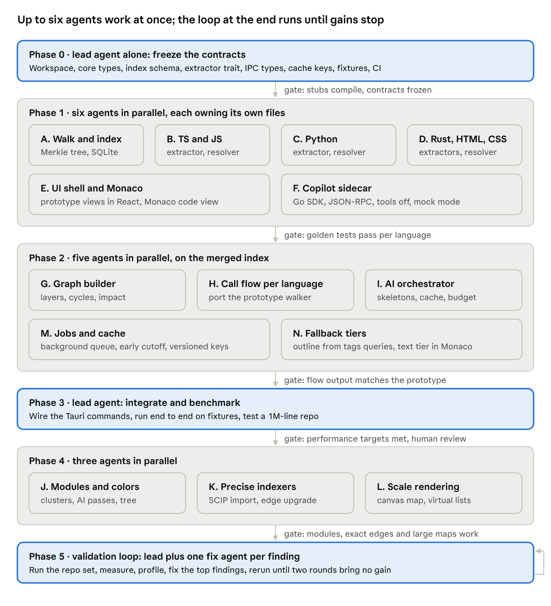

# Isoline: Implementation Plan for Agents

Nov 16, 2026 · @Zohaib Rauf

## How to use this plan

This is the build brief for a lead agent that implements Isoline, the code-understanding desktop app, and spawns helper agents for the parallel parts. It turns the [analysis plan](https://claude.ai/artifact/T7krtxdjhWTTUAKdt1cBYL) into contracts, workstreams and acceptance tests.

- **Goal:** a Tauri 2 desktop app (Windows, macOS, Linux) that opens a repo, indexes it with deterministic parsing, shows the prototype's three views for any file, shows code in the Monaco editor, and uses GitHub Copilot models only for summaries, module names and colors.

- **Reference behavior:** the [prototype code map](https://claude.ai/artifact/GrRiDmFVMJ9fsRmhw6wC1p). Cards, the dependency map and the call flow must behave like it.

- **Order:** the lead freezes the contracts alone (phase 0), spawns agents per phase, merges at each gate, then runs the validation loop (phase 5) until the numbers stop improving. Nothing in phases 1 or 2 needs a GitHub account or a network call.

- **Faster with use:** every derived result is cached by content hash and computed by a background queue, so a repo is slowest the first time and near-instant after.

- **No dead ends:** languages without a dedicated extractor still open, with an outline where a grammar exists and plain Monaco highlighting where none does.

- **Verify headless:** every feature is reachable from an iso-cli binary, so agents test with commands and golden files, not by looking at a window.

## Parser comparison and decision

Keep tree-sitter as the one parser for all five languages, add Oxc's resolver for JavaScript and TypeScript imports now, and leave a seam so Oxc's parser can replace tree-sitter for those two languages if the phase 3 benchmark asks for it.

One correction to the framing: the plan already parses with tree-sitter. The Sourcegraph tools (the SCIP indexers) are only the optional second pass that upgrades call edges to exact ones.

| Parser                                                                           | Languages         | Speed                                                                              | Broken code                                 | Reparse on edit         | Fit for this app                                                                                                 |
|----------------------------------------------------------------------------------|-------------------|------------------------------------------------------------------------------------|---------------------------------------------|-------------------------|------------------------------------------------------------------------------------------------------------------|
| [tree-sitter](https://github.com/tree-sitter/tree-sitter) 0.26                   | All five, one API | About 10 MB/s per core on Rust source; 2 to 3 times slower than rustc's own parser | Always returns a tree                       | Incremental, under 1 ms | **Base parser.** One query-driven extractor design for every language                                            |
| [Oxc](https://github.com/oxc-project/oxc) parser                                 | JS, TS, JSX, TSX  | Fastest: about 3x swc and 5x Biome; about 4 ms for a large TSX file                | Reports errors; partial tree not guaranteed | Full reparse            | **Fast path for JS and TS** if needed. Ships scopes and symbol binding too                                       |
| [Oxc resolver](https://docs.rs/crate/oxc_resolver/latest)                        | JS, TS imports    | Not a parser                                                                       | n/a                                         | n/a                     | **Adopt now.** Node ESM and CommonJS resolution, tsconfig paths, extends and project references                  |
| swc parser                                                                       | JS, TS            | About 3x slower than Oxc                                                           | Limited                                     | Full reparse            | No advantage over Oxc here                                                                                       |
| Biome parser                                                                     | JS, TS, CSS, JSON | About 5x slower than Oxc; builds a lossless tree                                   | Strong recovery                             | Full reparse            | Only if lossless trees matter; they do not here                                                                  |
| [Ruff parser](https://docs.rs/ruff_python_parser/)                               | Python            | Hand-written, fast                                                                 | Recovers                                    | Full reparse            | Fast path for Python later. Check how it is published before depending on it; vendored copies exist on crates.io |
| [ra_ap_syntax](https://docs.rs/ra_ap_syntax/latest/src/ra_ap_syntax/lib.rs.html) | Rust              | Hand-written                                                                       | Graceful                                    | Incremental             | Fast path for Rust later. Versioned 0.0.x, so the API moves                                                      |
| syn                                                                              | Rust              | Fast                                                                               | Fails on any error                          | Full reparse            | Not usable for code being edited                                                                                 |

Why tree-sitter stays the base:

- **Parsing is not the bottleneck.** A 1M-line repo is about 40 MB of source. At tree-sitter's roughly 10 MB/s per core that is about 4 seconds on one core and under 1 second on eight. Import resolution, graph building and database writes will cost more.

- **One design, five languages.** Symbols, imports and call flow come from queries plus a small node-kind mapping per language. Native parsers mean three different syntax trees and three separate call-flow walkers.

- **It never fails on half-typed code,** and editing a file reparses only the changed part.

- **It is actively maintained:** 0.26.11 shipped in July 2026.

Where faster parsers earn their place:

- **Oxc resolver from day one.** Import resolution is where hand-rolled heuristics go wrong, and it works with any parser.

- **Oxc parser as a swap-in.** It is production ready and backed by VoidZero, which Cloudflare bought in June 2026. Its semantic pass would also give exact same-file symbol binding for JS and TS, which tree-sitter cannot.

- **Decide with numbers.** Phase 3 benchmarks tree-sitter against Oxc on the same TS corpus. Swap only if indexing misses its target or call edges for JS and TS are too noisy.

## Unsupported languages and the Monaco editor

Every file opens in Monaco and every language lands in one of three support tiers, so nothing in a repo is a dead end.

| Tier        | Languages                                                                                 | What the user gets                                                                                                         | How it works                                                                                                                            |
|-------------|-------------------------------------------------------------------------------------------|----------------------------------------------------------------------------------------------------------------------------|-----------------------------------------------------------------------------------------------------------------------------------------|
| 1\. Full    | TypeScript, JavaScript, Python, Rust, HTML, CSS                                           | Cards, dependency map, call flow, summaries                                                                                | A dedicated extractor and import resolver                                                                                               |
| 2\. Outline | Any language with a tree-sitter grammar and a tags query, such as Go, Java, C#, C and C++ | Symbol outline, file-level imports where the query finds them, summaries. No call flow; edges are marked heuristic         | One generic extractor driven by the grammar's tags query. Adding a language means adding grammar and query files, with no new Rust code |
| 3\. Text    | Everything else                                                                           | Monaco syntax highlighting where it knows the language, search, a file-level AI summary, a module color from its directory | No parsing at all                                                                                                                       |

- **Monaco is the code view for every tier.** It is the [editor component that powers VS Code](https://github.com/microsoft/monaco-editor), MIT licensed and built to embed in a web view. It replaces the prototype's hand-written highlighter.

- **VS Code itself and its extensions cannot be embedded.** Monaco's own FAQ says VS Code extensions do not run in it. Language features come from our index, not from extensions.

- **Our features sit on Monaco's extension points:** line decorations mark the current call-flow step, and go-to-definition, hover and outline are answered from the Isoline index.

- **All editor access goes through one EditorHost wrapper in app/ui.** It starts read-only. That one seam is where later features attach: editing and saving, the diff view for reviewing changes, inline AI notes, and language servers through Monaco's LSP client (alpha today) or [monaco-languageclient](https://www.typefox.io/blog/monaco-languageclient-v10/).

- **Language servers are also the upgrade path for tier 2,** giving exact definitions and references without writing an extractor.

- **The tier is always visible:** a badge on each file and a per-repo count, so the user knows why a file has no call flow.

## Ground rules for the lead and its agents

The lead owns the contracts and the merges; each spawned agent owns a fixed set of files and proves its work with tests.

- **File ownership is exclusive.** An agent edits only the paths named in its row of the task table. Each agent works in its own git worktree and branch.

- **Contracts change only through the lead.** iso-core types, the index schema, the extractor trait and the IPC types are frozen after phase 0. An agent that needs a change stops and asks the lead, which updates the contract and tells every affected agent.

- **Done means green.** cargo fmt --check, cargo clippy -- -D warnings and cargo test pass, the golden files for the agent's fixtures match, and the agent reports what it built, what it skipped and why.

- **Golden tests are the spec.** Each fixture repo has expected symbols, imports, calls and call-flow trees as JSON. Agents write these first, by hand, for a few small files, and never regenerate them just to make a test pass.

- **No model calls in tests.** iso-ai talks to a Provider trait; tests use a mock that returns canned answers and counts tokens.

- **No network outside the sidecar.** The Rust crates and the UI never open a socket.

- **Check versions before pinning.** This plan names crates, not versions. Look up each crate's current release and pin it in the workspace manifest.

- **Keep heavy work in Rust.** The UI receives ready-to-render data over IPC and never parses code.

- **Stop for the items under "What needs a human".** Do not work around them.

Brief to give each spawned agent:

```markdown
You own: <paths>. Do not edit anything else.
Read first: CONTRACTS.md, the fixtures under fixtures/<lang>, and this plan's row for <workstream>.
Build: <deliverable>.
Done when: <acceptance test> passes, plus fmt, clippy and cargo test.
If a contract blocks you, stop and report the exact change you need.
Report back: files changed, tests added, anything skipped, open risks.
```

## Repo layout and shared contracts

The lead writes these four contracts in phase 0 and commits them as CONTRACTS.md plus compiling stubs; everything else builds against them.

```text
isoline/
  crates/
    iso-core      shared types only, no IO
    iso-index     SQLite schema, migrations, typed queries
    iso-walk      gitignore-aware walk, content hashing, Merkle tree, file watcher
    iso-parse     tree-sitter parser pool; lang/<language>.rs + queries/<language>/*.scm; lang/generic.rs
    iso-resolve   import resolution; one module per language (oxc_resolver for JS and TS)
    iso-graph     layers, cycles, clusters, impact
    iso-cache     versioned content-addressed store, early cutoff
    iso-jobs      priority background queue, persisted and resumable
    iso-ai        skeletons, Provider trait, budget
    iso-cli       headless commands: index, file, flow, impact, bench, eval
  sidecar/copilot   Go: Copilot SDK behind JSON-RPC on stdio
  app/src-tauri     Tauri commands; thin wrappers over the crates
  app/ui            React + TypeScript + Vite; Monaco behind EditorHost
  fixtures/<lang>/  small repos with expected output as JSON
  eval/             repos.toml, results/<round>.json, reports
```

**1. Core types (iso-core).** Stable ids are hashes, so they survive reindexing.

```rust
pub struct FileId(pub u64);    // hash of repo-relative path
pub struct SymbolId(pub u64);  // hash of file path + qualified name + kind
pub enum Confidence { Exact, Heuristic, Inferred }
pub enum EdgeKind { Import, Call, TypeUse }
pub struct Edge { pub from: SymbolId, pub to: Target, pub kind: EdgeKind, pub confidence: Confidence, pub line: u32 }
pub enum Target { Symbol(SymbolId), External { module: String, name: String }, Unresolved(String) }

// Call flow: same shape as the prototype's analyze.js output
pub enum FlowItem {
    Call { label: String, target: Target, line: u32, awaited: bool, arg_of: Option<String>, inner: Vec<FlowItem> },
    Block { kind: BlockKind, keyword: String, label: String, line: u32, children: Vec<FlowItem> },
    Exit { kind: ExitKind, label: String, line: u32, early: bool },
}
pub enum BlockKind { Cond, Try, Catch, Finally, Loop, Callback, Inline, Deferred }
```

**2. Extractor interface (iso-parse).** One implementation per language. It sees one file and never touches the database.

```rust
pub trait Extractor: Send + Sync {
    fn language(&self) -> Language;
    fn extract(&self, path: &Path, source: &str, tree: &tree_sitter::Tree) -> FileFacts;
    fn flow(&self, source: &str, tree: &tree_sitter::Tree, symbol: &SymbolFact) -> Vec<FlowItem>;
}
pub struct FileFacts { pub symbols: Vec<SymbolFact>, pub imports: Vec<ImportFact>, pub calls: Vec<CallFact> }
```

extract runs at index time for every file. flow runs on demand when a file is opened, so call-flow trees are never stored for the whole repo.

**3. Index schema (iso-index).** SQLite in WAL mode, one database per repo under the app data folder.

```sql
files(id, path, lang, tier, size, mtime, content_hash, parsed_at)
tree_nodes(path, kind, hash, parent_path)         -- Merkle tree: file hash, or hash of a directory's children
symbols(id, file_id, name, qualified_name, kind, start_line, end_line, signature, doc, exported, body_hash)
imports(file_id, specifier, resolved_file_id, names_json, type_only, line)
edges(from_symbol, to_symbol, to_external, kind, confidence, line)
modules(id, name, role, color, source)            -- source: cluster | ai | user
file_modules(file_id, module_id)
derived(kind, key_hash, version, value, created_at)  -- cache for facts, flows, graph aggregates
ai_cache(content_hash, prompt_version, model, kind, output_json, tokens_in, tokens_out, created_at)
jobs(id, kind, target, priority, state, attempts, updated_at)
meta(key, value)                                  -- schema version, root hash at last index
```

derived and ai_cache are keyed by content hash plus a version, so the same code is never processed twice and upgrading one extractor or prompt invalidates only its own rows. ai_cache lives in a database shared by all repos.

**4. IPC commands (app/src-tauri).** The UI calls only these. Types are generated for TypeScript from the Rust structs.

| Command                                                              | Returns                                                   | Notes                                                      |
|----------------------------------------------------------------------|-----------------------------------------------------------|------------------------------------------------------------|
| open_repo(path)                                                      | Repo summary; starts background indexing                  | Emits index_progress events                                |
| get_tree()                                                           | Directory tree with module and color per file             | From the index only                                        |
| get_file_view(path)                                                  | Symbols, layers, in-file edges, imports, cached summaries | Reparses if the file is stale                              |
| get_flow(symbol_id)                                                  | Call-flow tree                                            | Computed on demand                                         |
| get_source(path, range)                                              | Source text for a line range                              | Lazy code expansion                                        |
| get_impact(symbol_id, transitive)                                    | Dependents and dependencies                               | From the graph                                             |
| get_module_map()                                                     | Modules and edges between them                            | Aggregated, for large repos                                |
| search(query)                                                        | Symbols and files                                         | Index lookup                                               |
| ai_status(), ai_sign_in(), ai_estimate(scope), ai_run(scope, budget) | Sign-in state, cost estimate, job handle                  | Emits ai_progress, summary_ready events                    |
| get_jobs()                                                           | Background queue state and cache hit rate                 | Emits job_progress events; drives the per-file status dots |

## Caching, background work and incremental updates

Nothing is computed twice and nothing off-screen blocks the screen: a Merkle tree finds what changed, a dependency-aware cache decides what to redo, and a priority queue does the work in the background.

**Is a Merkle tree better?** Yes for finding changes, but it is not enough alone for deciding what to recompute.

- **What it is here:** each file's node is the hash of its content, and each directory's node is the hash of its children's names and hashes, stored in tree_nodes.

- **What it buys:** reopening a repo or switching branches compares the root hash and descends only into directories that differ, so the cost follows the size of the change, not the size of the repo. Directory hashes also make good cache keys for module-level results.

- **Cheap to build:** git already stores a Merkle tree of every commit, so files unchanged since HEAD take their hash from git. Only modified and untracked files are hashed, after a quick size and modified-time check.

- **Its limit:** it says which files changed, not which results depended on them. Editing a.ts can make an edge stored for b.ts wrong.

So the tree feeds a pipeline that stops as early as it can:

1.  **Detect.** A watcher event or a Merkle diff gives the changed files.

2.  **Reparse** only those files, incrementally when the old syntax tree is still in memory.

3.  **Cut off early.** Hash the new facts. If a file's exported symbols are unchanged (a comment or function-body edit), its dependents are left alone. If a symbol's body_hash is unchanged, its flow tree and summary stay.

4.  **Re-resolve** only the files that import a file whose exports changed, found through the reverse import index.

5.  **Regraph** only the affected connected component for layers and cycles. Module membership is recomputed only when edges cross a module boundary.

6.  **Queue AI work** only for symbols whose body changed. A module summary reruns only when its children's summaries changed, and the repo overview only when a module summary changed. AI jobs wait for the user's budget and never run unasked.

| Cached result                        | Key                                               | Kept in                                                |
|--------------------------------------|---------------------------------------------------|--------------------------------------------------------|
| Syntax trees                         | File content hash                                 | Memory, least recently used, for open and recent files |
| File facts (symbols, imports, calls) | Content hash + extractor version                  | derived; reused across branches                        |
| Resolved edges                       | File hash + hashes of its import targets' exports | edges                                                  |
| Call-flow trees                      | Symbol body hash + walker version                 | Memory, plus derived for files already opened          |
| Layers, cycles, clusters             | Hash of the component's edge set                  | derived                                                |
| Summaries, module names              | Content or body hash + prompt version + model     | ai_cache, shared across repos                          |

Background processing (iso-jobs):

- **Priority order:** the visible file, then the files it imports and that import it, then files in expanded directories and recently opened files, then the rest of the repo, then precise indexers, then AI passes.

- **Resumable:** job state is persisted, so closing the app mid-index loses nothing that finished.

- **Polite:** the pool uses all cores but one, and yields while the user is scrolling or typing.

- **Warm start:** on reopen, facts for the last session's open files load first.

- **Visible progress:** the tree appears at once, each file shows indexed or pending, and views fill in as jobs finish.

- **Measured:** cache hit rate and recompute counts are logged per operation, so the validation loop can prove the app gets faster with use.

## Workstreams

Six phases; the lead works alone in phases 0 and 3, spawns agents for phases 1, 2 and 4, and runs phase 5 as a loop.



workstreams · 6 phases, 14 agent assignments plus the validation loop

E and F have no dependency on the parsing work, so they can keep running through phase 2 if they need longer.

## Tasks and acceptance tests

Each row is one agent's whole assignment; the acceptance test is what the lead checks before merging.

| Phase | Workstream                                | Owns                                                                  | Build                                                                                                                                                                                                          | Done when                                                                                                                                                    |
|-------|-------------------------------------------|-----------------------------------------------------------------------|----------------------------------------------------------------------------------------------------------------------------------------------------------------------------------------------------------------|--------------------------------------------------------------------------------------------------------------------------------------------------------------|
| 0     | Contracts (lead)                          | Workspace root, iso-core, CONTRACTS.md, fixtures/, CI                 | Cargo workspace, stub crates, the contracts (types, extractor, schema, IPC, cache keys, job kinds), 3 to 5 small fixture files per language with hand-written expected JSON, CI on Windows, macOS and Linux    | cargo build passes on all three systems with every stub in place                                                                                             |
| 1     | A. Walk, tree and index                   | iso-walk, iso-index                                                   | Gitignore-aware parallel walk, Merkle tree seeded from git's hashes, diff between two trees, watcher with debounce, schema and migrations, batched writes                                                      | Reindexing an unchanged fixture hashes and writes nothing; a branch switch that touches 3 files reports exactly those 3                                      |
| 1     | B. TS and JS                              | iso-parse/lang/ts.rs, js.rs, their queries, iso-resolve/js.rs         | Symbols, imports, calls for TS, TSX, JS, JSX; resolution through oxc_resolver with tsconfig auto-discovery                                                                                                     | Golden files match; path aliases and index.ts barrels resolve in the monorepo fixture                                                                        |
| 1     | C. Python                                 | iso-parse/lang/python.rs, queries, iso-resolve/python.rs              | Symbols including classes, methods and decorators; absolute and relative imports; package roots from pyproject.toml and \_\_init\_\_.py                                                                        | Golden files match; relative imports resolve across packages in the fixture                                                                                  |
| 1     | D. Rust, HTML, CSS                        | iso-parse/lang/rust.rs, html.rs, css.rs, queries, iso-resolve/rust.rs | Rust items, impl methods, mod tree and use paths across a Cargo workspace; HTML script and stylesheet links, ids and classes                                                                                   | Golden files match; use crate::a::b resolves to the right file in a two-crate fixture                                                                        |
| 1     | E. UI shell and Monaco                    | app/ui                                                                | React app with the prototype's three views and the source tree on mock data; Monaco as the code view behind EditorHost, with flow-step line decorations and tier badges; canvas for the map; virtualized lists | The prototype's file renders from a mock with the same cards, layers and call-flow steps; stepping the flow moves the Monaco highlight                       |
| 1     | F. Copilot sidecar                        | sidecar/copilot                                                       | Go binary: device-flow sign-in, listModels, one complete(model, system, prompt) call, token counts in every reply, all built-in tools excluded, a mock mode                                                    | In mock mode, JSON-RPC round trips pass; the live test is run once by a human                                                                                |
| 2     | G. Graph builder                          | iso-graph                                                             | Layers by longest path, cycles by strongly connected components, impact sets, module candidates from directories plus community detection, recompute per connected component                                   | On fixtures: layers match the hand-computed ones; a seeded cycle is reported; an edit in one component leaves the others untouched                           |
| 2     | H. Call flow                              | flow functions in iso-parse/lang/\*                                   | Port prototype/analyze.js to tree-sitter for TS and JS first, then Python and Rust, through one shared walker plus a node-kind table per language                                                              | Output for the TS fixtures equals what analyze.js produces on the same files; Python and Rust match hand-written goldens                                     |
| 2     | I. AI orchestrator                        | iso-ai                                                                | Skeleton builder, batching with a shared prompt prefix, cache lookups first, budget and cost estimate, leaf, cluster and repo passes behind Provider                                                           | With the mock provider: a second run makes zero calls; changing one function body makes one leaf call; the estimate is within 10% of counted tokens          |
| 2     | M. Jobs and cache                         | iso-jobs, iso-cache                                                   | Priority queue with persistence, cancel and resume; versioned content-addressed store; the early-cutoff pipeline from the caching section                                                                      | A body-only edit recomputes no dependents; an export change re-resolves only importers; killing the process mid-index and restarting redoes no finished file |
| 2     | N. Fallback tiers                         | iso-parse/lang/generic.rs, queries for Go, Java and C#                | Generic outline extractor driven by tags queries; tier detection per file; text tier for everything else                                                                                                       | The Go fixture yields an outline with no Go-specific Rust code; a file with an unknown extension opens in the text tier without errors                       |
| 3     | Integrate (lead)                          | app/src-tauri, iso-cli                                                | Wire every IPC command, bundle the sidecar, end-to-end test from open_repo to get_flow, benchmark tree-sitter against Oxc on one TS corpus                                                                     | The performance targets hold on a 1M-line repo, or the lead reports which one misses and why                                                                 |
| 4     | J. Modules and colors                     | iso-ai passes, tree coloring in app/ui                                | Run cluster and repo passes, store module names and colors, let the user rename and recolor, color new files by their directory and imports                                                                    | Labels are stable across two runs on the same repo; a user rename survives a rerun                                                                           |
| 4     | K. Precise indexers                       | iso-resolve/scip.rs                                                   | Detect scip-typescript, scip-python and rust-analyzer; run as low-priority jobs; import SCIP and upgrade edges to exact                                                                                        | On a fixture with a known wrong heuristic edge, the edge is corrected after the pass                                                                         |
| 4     | L. Scale rendering                        | app/ui map and lists                                                  | Module-level map by default, WebGL or canvas rendering, level of detail on zoom                                                                                                                                | A 5,000-node map pans at 60 frames per second on all three webviews                                                                                          |
| 5     | V. Validation loop (lead plus fix agents) | eval/, then whatever each fix needs                                   | The loop in the next section                                                                                                                                                                                   | The stop rule in the next section is met                                                                                                                     |

Notes for the lead:

- **Phase 1 language agents share iso-parse and iso-resolve** but each owns different files in them. The lead creates the empty files in phase 0 so no two agents add to the same module list.

- **Workstream H depends on B, C and D being merged,** because it adds the flow function to their files.

- **Card layout, colors and interactions** come from the prototype. E should read its source and reuse the layout algorithm for a single file.

- **prototype/analyze.js is in this package under prototype/.** It needs typescript@5.6.3 and prints the flow JSON for any TS file passed as its argument; use it to generate the TS goldens for workstream H.

## Validation and improvement loop

Phase 5 is a loop, not a checklist: run Isoline on real repos, measure, fix the worst problems, rerun, and stop only when two rounds in a row bring no meaningful gain.

**The repo set.** The lead proposes 8 to 10 public repos in eval/repos.toml, each pinned to a commit, and a human approves the list. It must cover:

- A large TypeScript monorepo with path aliases and project references

- An older JavaScript codebase on CommonJS

- A Python application with packages and relative imports

- A Rust workspace with several crates

- A polyglot repo mixing tier 1 languages with Go or Java

- A repo mostly in unsupported languages

- A repo over 1M lines, for scale

- A tiny repo under 50 files, for the first-run experience

- A repo with heavy generated or vendored code, to test ignore rules

**Each round:**

1.  **Run** iso-cli eval on every repo: cold index, reopen, 200 random file opens, 50 simulated edits, one branch switch.

2.  **Record** the metrics below to eval/results/\<round\>.json.

3.  **Check correctness.** Sample 100 call edges per repo against exact edges from a SCIP indexer where one runs. Count unresolved imports, empty or failed flow trees, and files per tier.

4.  **Profile** the slowest operation on each repo: a sampling profiler with flame graphs for Rust, timing spans around every pipeline stage, query plans for slow SQLite queries, and a webview performance trace for the slowest render.

5.  **Drive the real app** through Tauri's WebDriver support: open each repo, open files, step a call flow, and capture screenshots. A reviewer agent that wrote none of the code compares them with the prototype and lists breakages.

6.  **Triage.** The lead ranks findings by user impact, picks the top three to five, and spawns one fix agent per finding. Each fix starts by adding the failing case as a fixture or golden file.

7.  **Merge and rerun.** A fix that makes any metric worse is not merged.

| Metric                                         | Starting target                          |
|------------------------------------------------|------------------------------------------|
| Cold index speed                               | 1M lines per minute or better on 8 cores |
| Reopen an indexed repo                         | Under 1 s                                |
| Open a file, 95th percentile                   | Under 100 ms                             |
| Edit to refreshed view, 95th percentile        | Under 50 ms                              |
| Files reparsed after a one-file body edit      | Exactly 1, with 0 dependents recomputed  |
| Cache hit rate on reopen                       | Above 99%                                |
| Peak memory on the 1M-line repo                | Measured in round 1, then given a budget |
| Unresolved imports in tier 1 languages         | Under 5%, tightened after round 1        |
| Precision of heuristic call edges against SCIP | 90% or better                            |
| Panics and failed flow trees                   | 0                                        |
| AI cost estimate against actual tokens         | Within 10%                               |

- **Stop rule:** two rounds in a row where no metric improves by more than 5% and every correctness target is met. After six rounds without meeting it, the lead stops and reports what is still missing.

- **AI passes use the mock provider** in the loop. One live run on one repo happens only after a human approves the credit budget.

- **Regression guard:** CI runs the eval on the two smallest repos with a time budget, and every bug found becomes a permanent fixture.

## What needs a human

Five things an agent cannot do; none of them blocks phases 0 to 2.

- [ ] Register a GitHub OAuth or GitHub App for the device-flow sign-in and give the lead its client id (needed for workstream F's live test).

- [ ] Sign in once with a Copilot subscription to run the sidecar's live test, and approve a small credit budget for the first real AI passes in phase 4.

- [ ] Confirm that Copilot's terms allow bulk background analysis from a third-party desktop app.

- [ ] Approve the lead's list of validation repos, including the 1M-line benchmark repo used from phase 3 on.

- [ ] Provide code-signing identities for macOS and Windows before any build is distributed. Unsigned local builds are fine until then.

## Sources

- [tree-sitter](https://github.com/tree-sitter/tree-sitter) and its [0.26.11 release record](https://zenodo.org/records/21321112) (July 2026)

- [tree-sitter-rust: parse speed against rustc](https://docs.rs/crate/tree-sitter-rust/0.24.1)

- [Oxc project](https://github.com/oxc-project/oxc) and its [parser benchmark against swc and Biome](https://github.com/oxc-project/bench-javascript-parser-written-in-rust)

- [oxc_resolver](https://docs.rs/crate/oxc_resolver/latest) (docs.rs)

- [A look at the JavaScript Oxidation Compiler](https://blog.openreplay.com/javascript-oxidation-compiler/) (OpenReplay, on production use and the VoidZero acquisition)

- [ruff_python_parser](https://docs.rs/ruff_python_parser/) (docs.rs)

- [ra_ap_syntax](https://docs.rs/ra_ap_syntax/latest/src/ra_ap_syntax/lib.rs.html) (docs.rs)

- Copilot, SCIP and Tauri sources are listed in the [analysis plan](https://claude.ai/artifact/T7krtxdjhWTTUAKdt1cBYL).

<!-- -->

- [Monaco Editor](https://github.com/microsoft/monaco-editor) (Microsoft; its FAQ covers VS Code extensions and LSP)

- [monaco-languageclient v10](https://www.typefox.io/blog/monaco-languageclient-v10/) (TypeFox)
